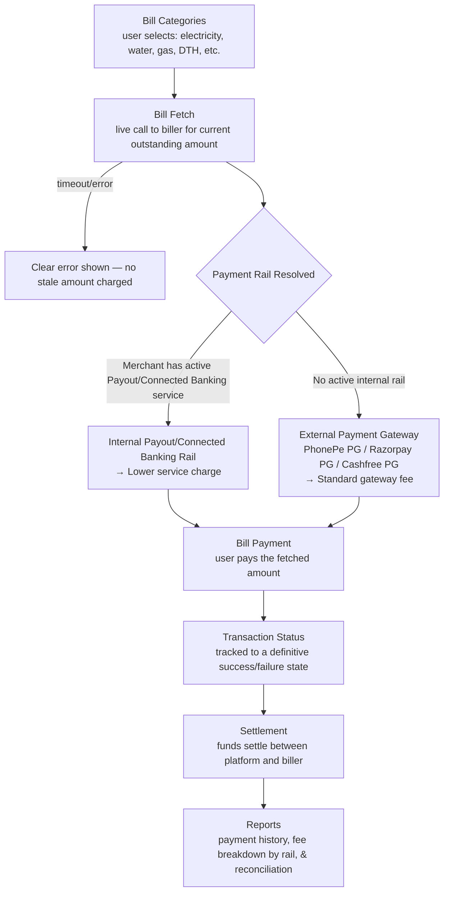

# 🧾 BBPS Bill Payment Platform

**A Bharat Bill Payment System (BBPS) integration platform — QA & Automation Portfolio Project**

> This repository documents the QA strategy, test automation, and testing approach applied to a
> **BBPS platform** — a bill aggregation and payment product that lets end users discover
> billers, fetch outstanding bills, and pay them through a single standardized interface.
>
> All content here uses **generic/sample data only**. No client names, company names, or
> confidential/production information are included. Dates and timelines are placeholders —
> update `[Timeline]` before publishing.
>
> 📍 **New here?** [`docs/README.md`](./docs/README.md) is a documentation map answering "what is
> this, how does it work, who's involved, what does it depend on" — with a recommended reading
> order through every doc in this repo.

---

## 📖 Table of Contents

1. [What is BBPS?](#-what-is-bbps)
2. [My Role](#-my-role)
3. [Tech Stack & Tools Used](#-tech-stack--tools-used)
4. [Types of Testing Performed](#-types-of-testing-performed)
5. [How It Works — Bill Payment Flow](#-how-it-works--bill-payment-flow)
6. [Key Achievements](#-key-achievements)
7. [Automation Approach](#-automation-approach)
8. [Regression Checklist](#-regression-checklist)
9. [Screenshots & Reports](#-screenshots--reports)
10. [Repository Structure](#-repository-structure)

> Deeper dives not covered inline in this README: [Modules, Submodules & Stakeholders](./docs/business-overview.md),
> [Architecture, Flow & Real Sequence Diagrams](./docs/architecture-and-flow.md),
> [Full Tech Stack & Skills Demonstrated](./docs/tech-and-skills.md),
> [Shared Platform Services](./docs/shared-platform-services.md), [UI Consistency](./docs/ui-consistency.md)
> — see [`docs/README.md`](./docs/README.md) for the full map. **Every diagram in this repo is
> drawn in Mermaid and renders natively right here on GitHub — nothing requires visiting another
> site.**

---

## 💡 What is BBPS?

**BBPS (Bharat Bill Payment System)** is a standardized bill payment ecosystem — a platform that
integrates with BBPS lets end users pay bills from any registered biller (electricity, water,
gas, DTH, telecom, etc.) through one consistent interface, instead of visiting each biller's own
portal.

If you're new to fintech QA, HR, or any non-technical role: think of it as a universal bill-pay
counter. The platform doesn't own the billers' data — it fetches live bill amounts from each
biller in real time, so a core testing challenge is that **the platform is only as reliable as
the biller integrations behind it**, several of which the team doesn't control.

### Core Flow

1. **Bill Categories** — the user selects a category (electricity, water, gas, DTH, etc.)
2. **Bill Fetch** — the platform calls the biller to retrieve the current outstanding amount
3. **Bill Payment** — the user pays the fetched amount
4. **Transaction Status** — the payment is tracked to a definitive success/failure state
5. **Settlement** — funds settle between the platform and the biller
6. **Reports** — payment history and reconciliation reporting

### Who typically interacts with it?

| Role | What they do |
|---|---|
| **End User** | Selects a bill category, fetches a bill, pays it, checks status |
| **Biller** | The utility/service provider whose bill is being fetched and paid |
| **Platform Admin/Ops** | Manages biller onboarding, monitors settlement, reviews failed-fetch/failed-payment trends |

---

## 👤 My Role

QA Engineer / SDET responsible for the BBPS module, owning manual and automated test coverage
across bill fetch accuracy, payment processing, and settlement reconciliation.

- Owned QA strategy for the bill category → fetch → payment → status → settlement journey
- Designed and executed automation covering bill fetch accuracy and payment status transitions
- Performed **API testing** validating bill-fetch responses, payment payloads, and status
  callbacks against biller-side behavior
- Focused test design on **biller-integration failure modes** — a category of defect largely
  outside the platform's own code, but still the platform's responsibility to handle gracefully
- Logged, triaged, and tracked defects through their full lifecycle

**Timeline:** `[Add Duration]`

---

## 🛠 Tech Stack & Tools Used

| Category | Tools |
|---|---|
| **UI Automation** | Cypress, JavaScript |
| **API Testing & Automation** | Postman |
| **Performance Testing** | k6 (bill-fetch load/spike testing around biller due-date clustering) |
| **CI/CD** | Jenkins / GitHub Actions |
| **Bug Tracking & Traceability** | JIRA, RTM (Requirement Traceability Matrix — see [`sample-rtm.md`](./sample-rtm.md)) |
| **Version Control** | Git, GitHub |

> Full detail on *why* each tool was chosen, a skill → proof map, and the performance testing
> approach in depth: [`docs/tech-and-skills.md`](./docs/tech-and-skills.md).

---

## 🧪 Types of Testing Performed

- **Functional Testing** — bill category selection, bill fetch, payment initiation
- **Regression Testing** — full fetch-to-settlement suite run before every release
- **API Testing** — bill fetch responses, payment payloads, status callbacks
- **Negative Testing** — biller timeout during fetch, stale bill amount at payment time, invalid
  biller reference
- **Reconciliation Testing** — settlement totals vs. payment totals
- **Performance Testing** — bill-fetch load and spike testing around biller due-date traffic
  clustering, validated with k6 (see [`docs/tech-and-skills.md`](./docs/tech-and-skills.md)
  section 5)
- **Smoke & Sanity Testing** — post-deployment health checks

---

## 🔄 How It Works — Bill Payment Flow



**Key testing principle:** the amount charged at payment time must always match the amount
fetched — if any time passes between fetch and payment, the platform must either re-validate the
amount or clearly flag it as potentially stale, never silently charge an outdated figure. **Also**
verify the correct payment rail (internal vs. external PG) is selected and the correct
corresponding fee is applied — see [`docs/business-overview.md`](./docs/business-overview.md)
section 3 for the full rationale and [`docs/architecture-and-flow.md`](./docs/architecture-and-flow.md)
for the full set of sequence diagrams, including exactly how a stale-amount charge and a
wrong-rail routing defect actually happen under the hood.

### Admin Functions

- Biller onboarding & category management
- Settlement monitoring
- Failed-fetch / failed-payment trend review
- Reports

---

## 🏆 Key Achievements

- Designed a bill-fetch-to-settlement regression suite treating **biller integration failure
  modes** (timeout, stale amount, invalid reference) as first-class test scenarios
- Validated transaction status accuracy across success, failure, and ambiguous/pending states
- Verified settlement reconciliation between platform-recorded payments and biller-side records
- Logged and tracked defects across bill-fetch accuracy and status-transition edge cases

---

## 🤖 Automation Approach

Automation is built with **Cypress + JavaScript**, covering the fetch-to-payment journey, backed
by Postman API coverage and k6 for bill-fetch load/spike testing (see
[`docs/tech-and-skills.md`](./docs/tech-and-skills.md) section 5).

### Priority Automated Scenarios

1. Bill category selection
2. Bill fetch (valid biller reference)
3. Bill fetch failure handling (simulated biller timeout)
4. Bill payment against a freshly fetched amount
5. Transaction status polling
6. Settlement reconciliation check
7. Bill-fetch load/spike testing around biller due-date clustering (k6)

See [`automation/`](./automation) for the framework README and a sample spec file using dummy
data.

---

## ✅ Regression Checklist

- [ ] Bill Categories
- [ ] Bill Fetch (valid / invalid biller reference)
- [ ] Bill Fetch failure handling (timeout, error response)
- [ ] Bill Payment
- [ ] Stale-amount protection (fetch vs. payment-time amount)
- [ ] Transaction Status
- [ ] Settlement
- [ ] Reports
- [ ] UI Consistency (status representation, formatting, terminology, accessibility)

Full checklist with edge cases available in [`regression-checklist.md`](./regression-checklist.md).

---

## 📸 Screenshots & Reports

Sample test execution reports, defect report templates, and a worked Requirement Traceability
Matrix are available in [`regression-execution-summary.md`](./regression-execution-summary.md),
[`sample-defect-report.md`](./sample-defect-report.md), and [`sample-rtm.md`](./sample-rtm.md).

---

## 📁 Repository Structure

> **New here?** Start with [`docs/README.md`](./docs/README.md) — a documentation map that
> answers "what is this, how does it work, who's involved, what does it depend on" and points to
> exactly the right doc for each question.

```
bbps-bill-payment-platform/
├── README.md
├── regression-checklist.md          → Full regression suite + edge cases
├── sample-defect-report.md          → Defect theme taxonomy + worked defect examples
├── sample-rtm.md                    → Worked Requirement Traceability Matrix, including real coverage gaps
├── regression-execution-summary.md  → Sample regression test execution report
├── docs/
│   ├── README.md                    → 📍 Documentation map — start here
│   ├── business-overview.md         → What BBPS is, modules/submodules, stakeholders, dependencies, glossary
│   ├── architecture-and-flow.md     → Real Mermaid sequence/flow diagrams: fetch, stale-amount guard,
│   │                                    rail selection, biller timeout, settlement — using the real
│   │                                    BBPCU/BBPOU/COU/BOU Bharat Connect participant structure
│   ├── tech-and-skills.md           → Full tech stack (with why), skill → proof map, CI/CD shape, performance depth
│   ├── shared-platform-services.md  → Company-wide services this product depends on (Auth, Settlement/Reconciliation Engines, etc.)
│   └── ui-consistency.md            → Cross-screen UI/UX consistency (status representation, formatting, a11y)
└── automation/
    ├── README.md                    → Framework setup & structure
    └── sample-bill-payment.spec.ts  → Sample Cypress test (dummy data)
```

> **Note on structure:** `bug-reports/`, `test-cases/`, and `test-reports/` were originally
> separate folders, each holding a single file — flattened to the repo root since a folder
> holding exactly one file adds navigation overhead without organizing anything. `docs/` and
> `automation/` remain folders because each genuinely groups multiple related files.

## 🤖 Support & Dispute Resolution

BBPS issues (bill-fetch failures, payment disputes, account detail changes) are handled by the
shared [AI Dispute Resolution Engine](https://github.com/ghanendra-sdet/ai-dispute-resolution-engine)
— a single AI-powered support layer common across Collection, Payout, Connected Banking, BBPS,
Reseller, and YOBO. It resolves ~80% of issues without human involvement, cutting average ticket resolution
time from a 24–72 hour baseline to under 6 hours.
