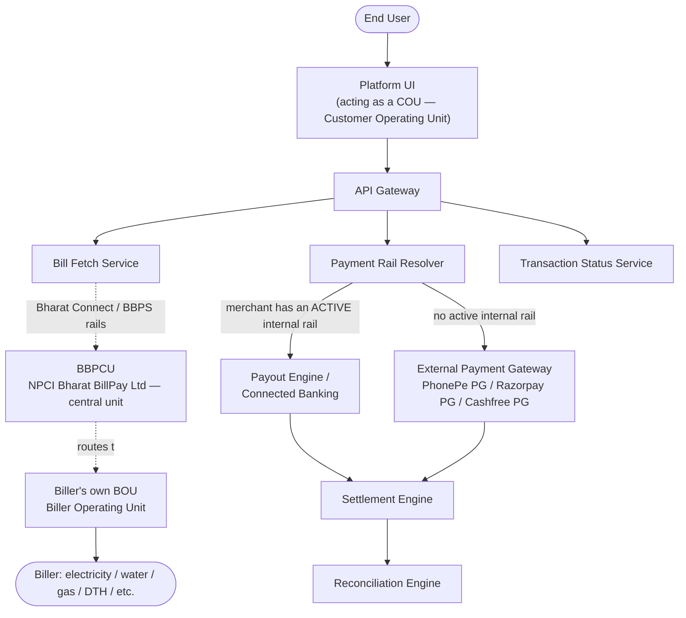
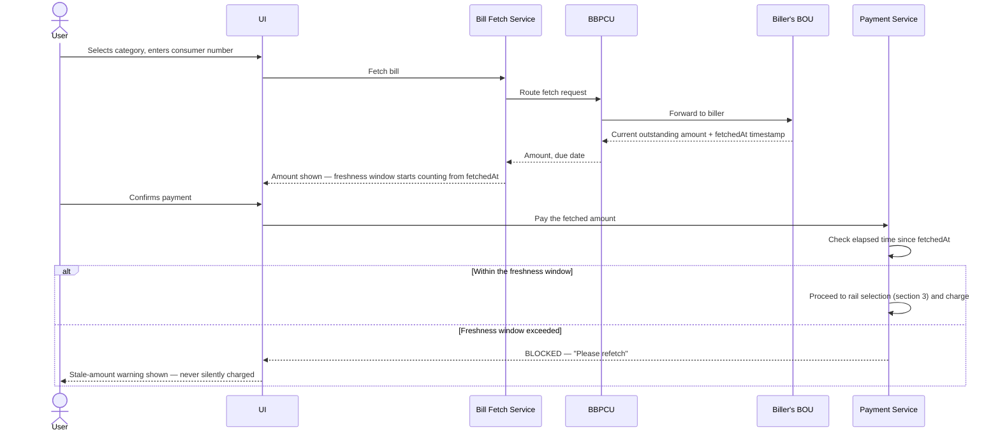
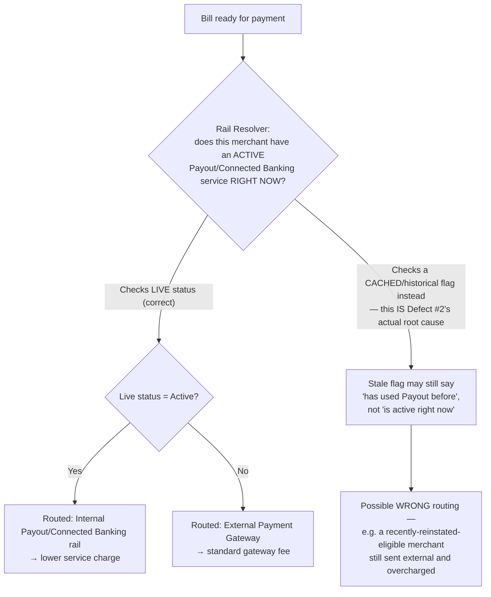
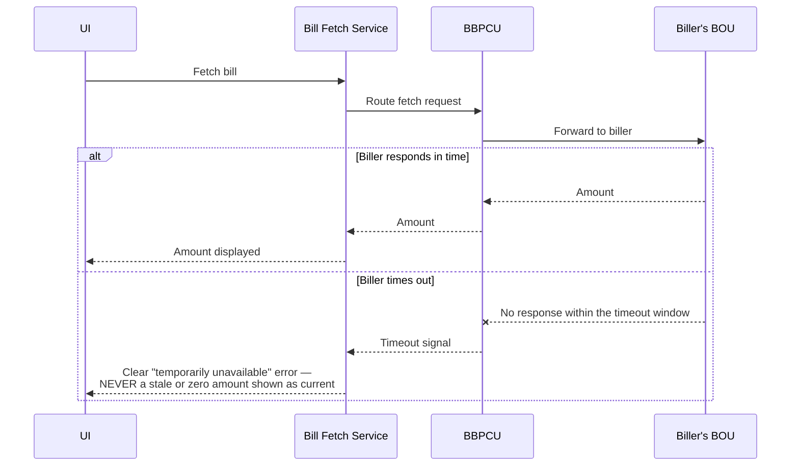
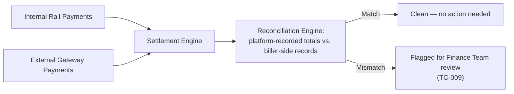

# BBPS — Architecture & Flow

> See [`business-overview.md`](./business-overview.md) for why biller-integration failure and
> dual-rail payment execution are this product's two central risks,
> [`tech-and-skills.md`](./tech-and-skills.md) for the tools and skills behind this testing
> approach, and [`README.md`](./README.md) for the full documentation map.
>
> `docs/README.md` noted this repo doesn't yet have the dedicated flow doc this portfolio's other
> fintech repos have — this is that doc. Every diagram below is drawn in
> [Mermaid](https://mermaid.js.org/), which GitHub renders natively in-page — nothing here
> requires opening another site or tool to read it.

## 1. System Architecture — Who Talks to Whom

**What "acting as a COU" means, concretely:** BBPS (rebranded **Bharat Connect** by NPCI in late
2024 — same underlying infrastructure, settlement rails, and biller network, just a new brand
name) is structured as a central unit plus two participant roles: the **BBPCU** (Bharat Bill Pay
Central Unit, operated by NPCI Bharat BillPay Ltd) sets the rules and runs the clearing/
settlement layer; **BBPOUs** (Bharat Bill Payment Operating Units — banks or authorized
non-banks) connect to it as either a **COU** (Customer Operating Unit, the customer-facing side —
what this platform is) or a **BOU** (Biller Operating Unit, the biller-facing side). This
platform never talks to a biller directly — every fetch and payment is mediated by the BBPCU,
which is exactly why biller-side failures (section 4 of
[`business-overview.md`](./business-overview.md)) are a structural risk this platform can
mitigate but never fully control.

## 2. Bill Fetch & Stale-Amount-Protected Payment

**This is the exact mechanism behind [`sample-defect-report.md`](../sample-defect-report.md)
Defect #1:** the diagram's `alt`/`else` branch simply didn't exist in the actual implementation —
every payment proceeded down the "within window" path regardless of how much time had actually
passed, because nothing checked `fetchedAt` at payment time at all. The fix isn't "add a timer to
the UI countdown" (the same mistake this guide's sibling repos warn about for their own
time-sensitive holds) — it's enforcing the elapsed-time check **inside the Payment Service
itself**, server-side, independent of anything the client displays.

## 3. Payment Rail Selection — the Exact Mechanism Behind Defect #2

**Why "ever had Payout" and "has Payout active right now" are different questions, and why the
difference matters commercially:** a merchant can deactivate and later reinstate their Payout/
Connected Banking relationship. A rail-resolver that checks a cached eligibility flag set once
and never re-verified will keep routing that merchant's bill payments externally — at the higher
fee — even after they've become eligible again for the lower one. This is a real-money,
real-recurring defect every single time that merchant pays a bill, not a one-off glitch, which is
exactly why [`sample-defect-report.md`](../sample-defect-report.md) rates it Major rather than
Minor: the impact compounds with every transaction until the live-check fix ships.

## 4. Biller Timeout — Never Show Stale Data as Current

**Why this diagram looks structurally identical to section 2's stale-amount diagram:** both are
the same underlying principle — *never present a number the platform can't currently vouch for as
if it's current* — applied at two different moments (fetch-time unavailability vs. payment-time
staleness). `TC-004` and `TC-006` in [`regression-checklist.md`](../regression-checklist.md) test
these as separate cases specifically because they're triggered differently (a biller outage vs.
elapsed time), even though the correct platform behavior rhymes.

## 5. Settlement & Reconciliation

**Why reconciliation has to compare against the *biller's* records, not just the platform's own
payment log:** per [`business-overview.md`](./business-overview.md) section 4, the platform
doesn't control the biller's side of this relationship — a payment the platform recorded as
successful could still be unrecognized on the biller's own ledger if a status callback was lost
or delayed (section 4 above), and reconciliation is the only process positioned to catch that
drift independently of either side's own optimistic self-report.

---

**Sources for the real-world standards referenced above** (used to ground this document's
diagrams in genuine BBPS/Bharat Connect architecture, not invented mechanics):
[Bharat Connect rebrand, BBPCU/BBPOU/COU/BOU structure — Wikipedia](https://en.wikipedia.org/wiki/Bharat_Connect),
[Bharat Connect participant roles and scope — Mindgate](https://www.mindgate.solutions/guides/bharat-connect-bbps/).
