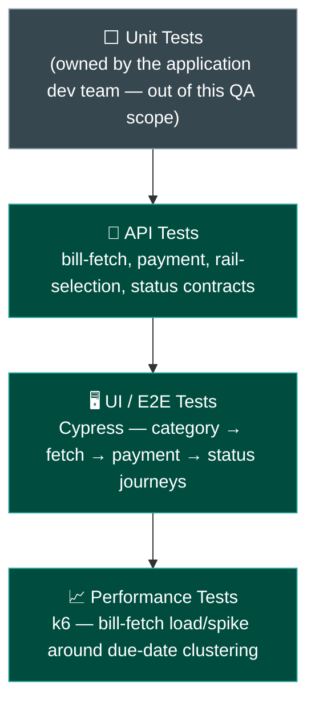
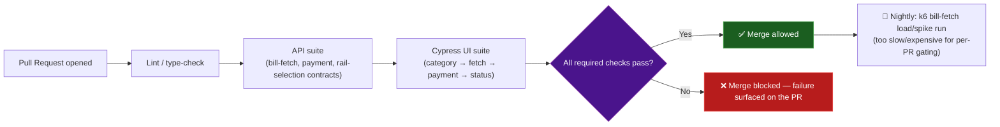

# BBPS — Tech Stack & Skills Demonstrated

> Everything in this doc is answerable by reading this repo alone — no need to visit an external
> site to understand what was used or why. See [`business-overview.md`](./business-overview.md)
> for the product/module breakdown and [`architecture-and-flow.md`](./architecture-and-flow.md)
> for how the system actually behaves.

## 1. Full Tech Stack, and Why Each Tool

| Category | Tool | Why This Tool Specifically |
|---|---|---|
| **UI Automation** | Cypress + JavaScript | Strong network-interception support (`cy.intercept`) matters here specifically because simulating biller timeouts, delayed status callbacks, and stale-amount scenarios is a core part of this module's test strategy, and none of those are easy to reproduce against a real biller on demand |
| **API Testing & Automation** | Postman | Validates bill-fetch responses, payment payloads, and rail-selection decisions directly against the contract, independent of what any one screen renders |
| **Performance Testing** | k6 | Load/spike testing for bill-fetch volume (section 5 below), chosen to stay in the same JS ecosystem as Cypress, and because this platform's real traffic shape is bursty around biller due dates, not steady |
| **CI/CD** | Jenkins / GitHub Actions | Automates the regression suite on a schedule/trigger — see section 4 for the suggested pipeline shape |
| **Bug Tracking & Traceability** | JIRA, RTM | Full defect lifecycle tracking plus requirement-to-test-coverage traceability — see [`../sample-rtm.md`](../sample-rtm.md) |
| **Version Control** | Git, GitHub | This repo itself; diagrams throughout are Mermaid, which GitHub renders natively with zero extra tooling |

## 2. Skills Demonstrated — Skill → Where to See It

| Skill | Demonstrated By | Where to Look |
|---|---|---|
| **Manual / Functional Testing** | Full category-to-settlement regression suite | [`../regression-checklist.md`](../regression-checklist.md) |
| **API Testing** | Bill-fetch, payment, and rail-selection contract validation, including negative cases (timeout, invalid reference) | [`../regression-checklist.md`](../regression-checklist.md) sections 1–2 |
| **UI Automation** | Cypress spec covering category listing, bill fetch, timeout handling, and the stale-amount block | [`../automation/sample-bill-payment.spec.ts`](../automation/sample-bill-payment.spec.ts) |
| **API Automation** | The same spec's `cy.intercept` usage doubles as automated API-contract verification — asserting the UI reacts correctly to specific biller response shapes (success, timeout, stale `fetchedAt`), not just that a button click works | [`../automation/sample-bill-payment.spec.ts`](../automation/sample-bill-payment.spec.ts) |
| **Performance Testing** | k6-based load/spike testing for bill-fetch volume around due-date clustering | Section 5 below |
| **Biller-Integration / Negative Testing** | A dedicated test category treating timeout, stale amount, and invalid reference as first-class scenarios, not edge cases | [`../regression-checklist.md`](../regression-checklist.md) section 1; [`../sample-defect-report.md`](../sample-defect-report.md) |
| **Regression Strategy & Prioritization** | Dual-rail payment selection and biller-failure modes both treated as dedicated test categories | [`../regression-checklist.md`](../regression-checklist.md) |
| **Requirement Traceability (RTM)** | A worked requirement → test case → status mapping | [`../sample-rtm.md`](../sample-rtm.md) |
| **Defect Management & Root-Cause Analysis** | Worked defects identifying the actual mechanism (a missing server-side freshness check; a cached rather than live eligibility flag) | [`../sample-defect-report.md`](../sample-defect-report.md) |
| **Test Reporting & Metrics** | A structured execution summary with pass/fail breakdown by area | [`../regression-execution-summary.md`](../regression-execution-summary.md) |
| **Technical Documentation & Communication** | This entire `docs/` set | This doc set, start to finish |

## 3. The Testing Pyramid Applied to This Project



## 4. CI/CD — Suggested Pipeline Shape

> **Note on scope, matching this repo's existing honesty convention** (see
> [`../automation/README.md`](../automation/README.md)): this repo includes one representative
> Cypress spec rather than a full framework, to stay focused as a portfolio piece. Jenkins/GitHub
> Actions are named in the tech stack as the intended CI tools; the pipeline below is the
> **suggested shape** that automation is designed to slot into, not a claim that a live CI
> instance with this exact pipeline is currently running against this repo.



## 5. Performance Testing, in Depth

Bill-payment traffic isn't steady. It clusters predictably around **biller due dates**, which
differ by category and biller. A platform integrating dozens of billers across 25+ categories
sees genuinely bursty load, not a flat daily average, and that shape is what this platform's
performance testing specifically targets.

| Test Type | What It Targets | Why It Matters Here Specifically |
|---|---|---|
| **Load test** | Sustained bill-fetch volume at a realistic peak rate | Confirms the Bill Fetch Service → BBPCU → biller's BOU path (see [`architecture-and-flow.md`](./architecture-and-flow.md) section 1) keeps pace with normal peak volume without latency creeping past the freshness window itself |
| **Spike test** | A sudden surge in fetch/payment requests in the last 1–2 days before a common due date (e.g., a major electricity biller's monthly cutoff) | This is this product's single most realistic high-traffic scenario — many customers across the same biller category converging on the same few days, not random uniform load |
| **Soak test** | Sustained moderate fetch/payment throughput over hours | Catches slow degradation in the rail-selection cache (section 3 of `architecture-and-flow.md`) or connection pooling that a short burst test can't reveal |

**A concrete, illustrative k6 spike-test scenario** — bill-fetch volume around a due-date surge:

```javascript
// k6/bill-fetch-due-date-spike.js — illustrative shape, dummy data only
import http from 'k6/http';
import { check } from 'k6';

export const options = {
  scenarios: {
    due_date_surge: {
      executor: 'ramping-arrival-rate',
      startRate: 20,
      timeUnit: '1s',
      preAllocatedVUs: 100,
      stages: [
        { duration: '1m', target: 20 },    // normal day-to-day rate
        { duration: '2m', target: 200 },   // due-date surge — 10x normal
        { duration: '3m', target: 200 },   // sustained peak
        { duration: '1m', target: 20 },    // surge subsides
      ],
    },
  },
  thresholds: {
    http_req_duration: ['p(95)<2000'],   // 95% of fetches complete under 2s even at peak
    http_req_failed: ['rate<0.02'],      // under 2% failure rate during the surge
  },
};

export default function () {
  const res = http.post('https://demo-env/api/bbps/fetch', JSON.stringify({
    category: 'Electricity',
    consumerNumber: 'DEMO-CONSUMER-00123',
  }), { headers: { 'Content-Type': 'application/json' } });

  check(res, { 'fetch responded successfully': (r) => r.status === 200 });
}
```

**What this script actually proves:** not "does one fetch succeed" — that's the functional
suite's job — but whether the fetch path holds its latency and error-rate targets specifically
during the 10x due-date spike, and, just as importantly, whether that added latency ever pushes
a successful-but-slow fetch response close enough to the freshness window (section 2 of
`architecture-and-flow.md`) to create a false stale-amount block for a customer who fetched and
paid promptly during a busy period.

## 6. Real-World Grounding — Industry Context

This project's architecture and terminology are deliberately grounded in the real Bharat Connect
(BBPS) ecosystem, not invented for the portfolio. See
[`architecture-and-flow.md`](./architecture-and-flow.md) section 1 for the full BBPCU/BBPOU/COU/
BOU mapping.

**Sources:**
<a href="https://en.wikipedia.org/wiki/Bharat_Connect" target="_blank" rel="noopener noreferrer">Bharat Connect rebrand, BBPCU/BBPOU/COU/BOU structure — Wikipedia</a>,
<a href="https://www.mindgate.solutions/guides/bharat-connect-bbps/" target="_blank" rel="noopener noreferrer">Bharat Connect participant roles and scope — Mindgate</a>.
